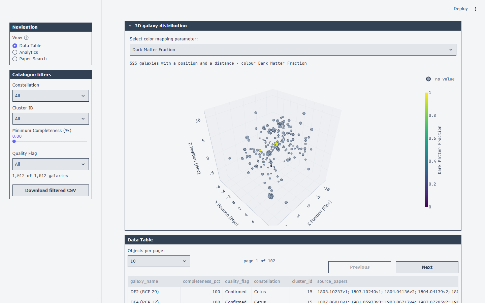
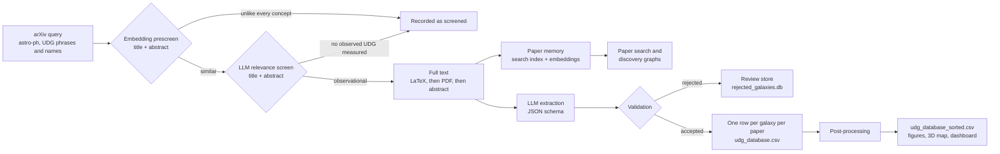
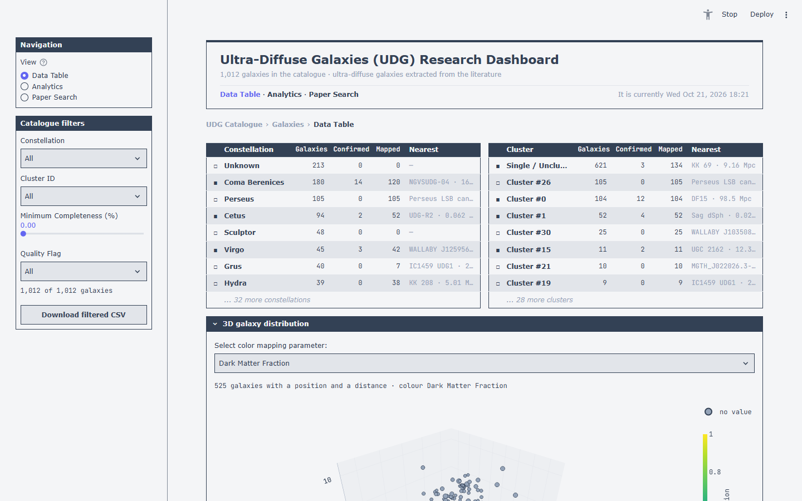
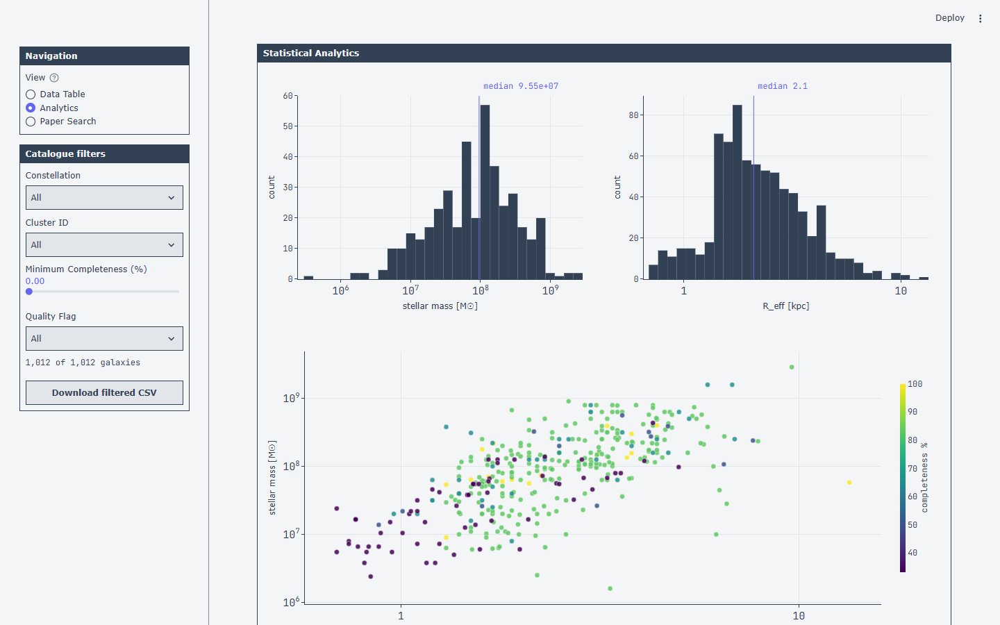
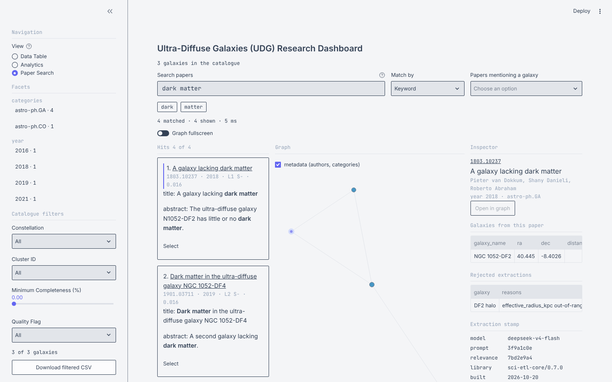

# udg-catalogue

[](https://github.com/xueromll/udg-catalogue/actions/workflows/ci.yml)
[](CHANGELOG.md)
[](#installation)
[](LICENSE)

**A literature-derived catalogue of 1,012 ultra-diffuse galaxies (UDGs) from 323 arXiv papers, where every galaxy names the papers its values came from, and the open pipeline that builds it.**

UDG measurements are scattered across hundreds of papers, in different tables, units and naming schemes. `udg-catalogue` reads that literature for you. It screens astro-ph submissions, reads each relevant paper's LaTeX source or PDF, has an LLM extract each galaxy's position, distance, effective radius, stellar mass and dark-matter fraction, validates every value against physical rules, and cross-identifies galaxies across papers by name and sky position. The result is one CSV you can load in a line of pandas, a dashboard with a 3D map, and full-text search over every paper behind it.

The pipeline runs on [sci-etl-core](https://github.com/xueromll/sci-etl-core), which handles fetching, extraction, caching, state and search. This repository holds the astronomy: prompts, validation rules, name and sky matching, and the dashboard.

> [!WARNING]
> **This is a prototype, not a confirmed scientific catalogue.** An LLM extracted the values automatically, and nobody has checked them against the original papers. They can be wrong, duplicated or misattributed (see [Known Limitations](#known-limitations)). Before you use any value, check it against the papers listed in `source_papers`, and cite those papers, not this catalogue.



## Contents

- [Features](#features)
- [Results at a Glance](#results-at-a-glance)
- [Quick Start](#quick-start)
- [Catalogue Schema](#catalogue-schema)
- [How It Works](#how-it-works)
- [Known Limitations](#known-limitations)
- [Citing and Data Use](#citing-and-data-use)
- [Installation](#installation)
- [Running the Pipeline](#running-the-pipeline)
- [Dashboard](#dashboard)
- [Configuration and Maintenance](#configuration-and-maintenance)
- [Project Structure](#project-structure)
- [Development](#development)
- [Documentation](#documentation)

## Features

**For research**

- **Provenance per paper.** The raw catalogue has one row per galaxy per paper, tagged with the paper's arXiv id. In the sorted catalogue, each galaxy lists every paper it was merged from.
- **Cross-identification.** Names are normalized and matched across aliases such as `Yagi276 (DF28)`. Records within 3″ are merged with astropy, including groups of three or more. Rows that share a field-local name such as `UDG 5` but lie in different fields stay separate.
- **Observational selection.** An embedding prescreen and then an LLM read each title and abstract. A paper is kept only when it measures specific observed UDGs, so simulations such as IllustrisTNG or FIRE, model fits to published values, and passing mentions are left out.
- **Physical validation.** Every extracted galaxy must pass validation rules before it is stored. Out-of-range values are rejected, never clipped, and each rejection is kept in a review store with the rule it broke.
- **A record of each run.** A run manifest records the library and catalogue versions, model, prompt hashes, query and papers behind the published catalogue.

**For exploring**

- **Interactive dashboard.** A Streamlit dashboard with a Plotly 3D map, filtering, analytics and CSV export.
- **Paper search.** Each relevant paper's full text is indexed for Boolean keyword search (SQLite FTS5 with BM25) and embedded for search by meaning. Hybrid search fuses both rankings, with category and year filters.
- **Discovery graphs.** Starting from any paper, the dashboard grows a graph of related papers, linked by similar content or shared authors, and groups them into communities.
- **Derived columns.** Each object gets a completeness score, a quality flag, its IAU constellation and a 3D spatial group from DBSCAN.

**For running it yourself**

- **Multi-format reading.** LaTeX sources come first (tarballs or single gzipped files, assembled in document order), then PDFs including their tables, and the abstract only as a last resort.
- **Polite arXiv access.** One arXiv request runs at a time, each starting 3–5 s (randomized) after the previous one ended. A 429 or 503 pauses every arXiv request for a minute, doubling while the throttling lasts, up to 15 minutes.
- **Pays once per paper.** Parsed full text is cached in `data/full_text/` by versioned arXiv id, and relevance and extraction answers are cached in SQLite, so reruns and rebuilds neither download nor pay twice.
- **Fault tolerance.** Requests are retried with backoff, and CSV and state writes are crash-safe. Papers that fail are retried on the next run instead of being marked done. Ctrl+C lets papers in progress finish before the run stops.
- **Bounded concurrency.** Up to 16 papers are processed at once. arXiv requests are paced by the polite limiter whatever this number is, so the extra papers are DeepSeek calls running alongside the downloads.
- **Containers.** A Dockerfile and a Compose file run the dashboard read-only and the pipeline as a separate service.

## Results at a Glance

From the rebuild of 2026-10-21:

| Metric | Value |
|---|---|
| **arXiv submissions screened** | 462 |
| **Papers read in full** | 323 |
| **Unique galaxies catalogued** | 1,012 |
| **Objects with all six measurements (`Confirmed`)** | 21 (2.1%) |
| **Objects with sky position and distance (3D map)** | 525 |
| **3D spatial groups (DBSCAN)** | 35 |
| **IAU constellations represented** | 39 |
| **Median record completeness** | 66.7% |
| **LLM tokens used** | 6.8 million |
| **ETL framework** | sci-etl-core 0.7 |

### Parameter coverage

| Parameter | Column | Unit | Objects | Coverage | Median |
|---|---|---|---:|---:|---:|
| Right ascension, declination (ICRS) | `ra`, `dec` | deg | 799 | 79.0% | — |
| Distance | `distance_mpc` | Mpc | 640 | 63.2% | 72.3 |
| Effective radius | `effective_radius_kpc` | kpc | 764 | 75.5% | 2.10 |
| Stellar mass | `stellar_mass_solar` | M☉ | 410 | 40.5% | 9.6 × 10⁷ |
| Dark-matter fraction | `dark_matter_fraction` | — | 29 | 2.9% | 0.94 |

## Quick Start

The published catalogue is one CSV file, so reading it takes pandas and no clone:

```python
import pandas as pd

url = "https://raw.githubusercontent.com/xueromll/udg-catalogue/main/data/udg_database_sorted.csv"
df44 = pd.read_csv(url).set_index("galaxy_name").loc["Dragonfly 44"]
print(df44.distance_mpc, df44.effective_radius_kpc, df44.stellar_mass_solar, df44.dark_matter_fraction)
# 100.0 3.8 300000000.0 0.98
print(df44.source_papers.count(";") + 1, "papers:", df44.source_papers[:40])
# 32 papers: 1410.8141v2; 1504.03320v1; 1606.06291v2;
```

Pick the path that fits what you want to do:

| To | Install | Then | API key |
|---|---|---|---|
| Use the published catalogue | `pip install pandas` | the snippet above | no |
| Explore the dashboard | `pip install -r requirements.txt` | `streamlit run app.py` | no |
| Run the dashboard in a container | Docker with Compose | `docker compose up --build` | no |
| Run the pipeline | `pip install -r requirements.txt` | `python main.py` | `DEEPSEEK_API_KEY` |
| Develop the pipeline | `pip install -r requirements/dev.txt` | `pytest --cov` | no |
| Change sci-etl-core alongside it | `pip install -r requirements/local.txt` | see [Developing Against a Local sci-etl-core](#developing-against-a-local-sci-etl-core) | no |

## Catalogue Schema

`data/udg_database_sorted.csv` has one row per object, sorted by completeness (descending), then by constellation, cluster and name. Empty cells mean the value was not reported or could not be extracted.

| Column | Type | Unit | Description |
|---|---|---|---|
| `galaxy_name` | string | — | Designation as first extracted |
| `completeness_pct` | float | % | Share of the six measurements present |
| `quality_flag` | string | — | `Confirmed`, `Needs Review` or `Low Confidence`, from completeness alone |
| `constellation` | string | — | IAU constellation, or `Unknown` without a valid position |
| `cluster_id` | integer | — | DBSCAN group label; −1 if ungrouped |
| `source_papers` | string | — | arXiv ids of the papers whose rows were merged into this object, separated by `; ` |
| `ra`, `dec` | float | deg | ICRS coordinates, decimal degrees |
| `distance_mpc` | float | Mpc | Distance |
| `effective_radius_kpc` | float | kpc | Effective (half-light) radius, physical |
| `stellar_mass_solar` | float | M☉ | Stellar mass |
| `dark_matter_fraction` | float | — | Dark-matter fraction in [0, 1] |

**Measurement conventions.** Each value is the central value reported by its paper. Error bars and limits are not kept, and definitions are not homogenized across papers: the distance method, the photometric band of the effective radius and the aperture of the dark-matter fraction differ from paper to paper and are not recorded (see [Known Limitations](#known-limitations)).

### Derived columns

- `completeness_pct` is the share of the six measurements (`ra`, `dec`, distance, effective radius, stellar mass, dark-matter fraction) that are present.
- `quality_flag` is `Confirmed` at 100% completeness, `Needs Review` at ≥ 50% and `Low Confidence` below 50%. **It measures completeness only, not whether the object is a confirmed UDG or whether its values are correct.**
- `constellation` is the IAU constellation of the position, from `SkyCoord.get_constellation`.
- `cluster_id` comes from DBSCAN (`eps = 5 Mpc`, `min_samples = 2`) on heliocentric Cartesian coordinates $(D\cos\delta\cos\alpha,\ D\cos\delta\sin\alpha,\ D\sin\delta)$. It is −1 for ungrouped objects and for objects without a position or distance. The groups are not bound structures.

### Raw catalogue

`data/udg_database.csv` has one row per galaxy per paper: `record_id` (the arXiv id), `galaxy_name`, the six measurements as the model returned them, and `extra`, a JSON object holding any other fields the model returned. It is not committed; `data/run_manifest.json` records its row count and SHA-256. When papers disagree, the raw catalogue keeps every paper's value.

## How It Works



### 1. Selection

The arXiv query is paged from the newest submission. It matches astro-ph papers whose title or abstract contains the phrase "ultra-diffuse" (which also matches "ultra diffuse"), "ultradiffuse", "UDG(s)", "SMUDGes", or the names NGC 1052-DF2, NGC 1052-DF4 and Dragonfly 44, which many papers on those UDGs use without saying "ultra-diffuse". The phrase is quoted because arXiv splits an unquoted `ultra-diffuse` into two words, which matched unrelated papers on diffuse radio emission or interstellar ices.

An embedding prescreen first drops listings unlike every UDG concept. The LLM then keeps papers that measure specific observed UDGs, new or re-analyzed, and rejects simulations, model fits to published values, and papers that mention UDGs only in passing. Every screened id is saved and never screened again. Code: [pipeline.py](udg_catalogue/pipeline.py), [prompts.py](udg_catalogue/prompts.py).

### 2. Extraction

For each object the paper classifies as a UDG or UDG candidate, DeepSeek V4-Flash in JSON mode returns `galaxy_name`, `ra`, `dec`, `distance_mpc`, `effective_radius_kpc`, `stellar_mass_solar` and `dark_matter_fraction`. The prompt fixes the units:

- positions in ICRS decimal degrees, with sexagesimal positions converted;
- distances in Mpc;
- effective radii in physical kpc, never converted from an angle;
- stellar masses in solar masses, converted from logarithms;
- percentages as fractions.

Only central values are kept, and values the paper does not report, limits included, are `null`. Code: [prompts.py](udg_catalogue/prompts.py).

At the same time, each relevant paper's title, abstract, full text, authors, categories and year go into a keyword index (`paper_index.db`), and the full text is split into 350-word passages and embedded into `paper_memory.db`. A failure here is logged and never costs the paper its extraction. Code: [literature.py](udg_catalogue/literature.py).

### 3. Validation

A record is rejected when any of these holds:

| Check | Rejected when |
|---|---|
| Name | Missing; contains a simulation keyword as a whole word (e.g. `tng`, `mock`, `toy`); or only identifies the object within its paper, such as `4692`, `ID 4692`, `No. 12`, `Object 3`, `source 7` or `# 5` |
| Right ascension | Outside [0°, 360°] |
| Declination | Outside [−90°, 90°] |
| Distance | Outside (0, 10⁴] Mpc |
| Effective radius | Outside (0, 100] kpc |
| Stellar mass | Outside (0, 10¹²] M☉ |
| Dark-matter fraction | Outside [0, 1] |
| Content | No physical measurement, and not both RA and Dec |

Out-of-range values are rejected, not clipped, because a value such as a dark-matter fraction of 96 usually means the paper was misread. Each rejected galaxy is logged with its reason and stored in `data/rejected_galaxies.db` with a rule code: `no-name`, `paper-local-name`, `simulation-keyword`, `not-a-number`, `not-positive`, `out-of-range` or `no-measurement` (see [Reviewing Rejected Galaxies](#reviewing-rejected-galaxies)). Accepted galaxies are appended to `udg_database.csv` with the paper's arXiv id in `record_id`; a paper that is extracted again replaces its own rows. Code: [validation.py](udg_catalogue/validation.py), [pipeline.py](udg_catalogue/pipeline.py).

### 4. Cross-identification

**By name.** Names are compared after normalization: NFKC and case folding, punctuation removed, `Dragonfly` → `DF`, leading zeros stripped. A leading `UDG` label before a designation is dropped, so `DF 44`, `DF-44`, `Dragonfly 044` and `UDG-DF44` match, while `KDG 44` and `DF 44` stay distinct, and so does `UDG 7`. A name with aliases in parentheses matches each of them: `Yagi276 (DF28)` matches `DF28`. Code: [naming.py](udg_catalogue/naming.py).

**Namesakes.** Rows that share a name but lie more than 10′ apart are different galaxies, as when two papers on different fields each number their UDGs 1, 2, 3. A row without a position then joins the galaxy whose distance agrees with its own within a factor of 1.5, and stays apart when none does.

**By position.** Every pair of rows within 3″ is found with `SkyCoord.search_around_sky`, and pairs that share a row are grouped, so exact duplicates and groups of three or more become one row. Code: [astrometry.py](udg_catalogue/astrometry.py).

**Merging.** When rows are merged, the values of the first paper processed are kept, and later papers only fill values it lacks. Merging fills gaps without discarding values.

### 5. Post-processing

The sorted catalogue is built from the raw catalogue alone. Measurements given as text, such as `3.2 ± 0.4`, are left empty here and stay readable in the raw catalogue. Each merged galaxy lists its papers in `source_papers`; completeness, constellation, spatial group and quality flag are computed, and rows are sorted. Values are kept as extracted; nothing is clipped. Code: [postprocess.py](udg_catalogue/postprocess.py).

## Known Limitations

Values are extracted automatically, so check them against the original papers before using them in quantitative work.

**Extraction**

- **Unchecked extraction.** No values were checked by hand, and a few are physically implausible (for example, one object has $M_\star > 10^{11}$ M☉).
- **Provenance per object, not per value.** `source_papers` lists the papers each object's rows came from, and the raw catalogue keeps every paper's values, but the sorted catalogue does not say which paper each value came from. Error bars and upper limits are discarded.
- **Dark-matter fractions on a bound.** The catalogue rebuilt on 2026-10-21 holds 3 dark-matter fractions of exactly 0 and 5 of exactly 1. The zeros include NGC 1052-DF2 and NGC 1052-DF4, which papers report as lacking dark matter, but a bound can also be a misread limit, so check these against their papers.

**Definitions**

- **Mixed definitions.** Distance methods, photometric bands and dark-matter apertures differ between papers and are not recorded.
- **No UDG definition imposed.** The catalogue takes each paper's classification as given and applies no size or surface-brightness cut, such as $R_\mathrm{e} \geq 1.5$ kpc and $\mu_{0,g} \geq 24$ mag arcsec⁻² ([van Dokkum et al. 2015](https://doi.org/10.1088/2041-8205/798/2/L45)).
- **First value wins.** When papers disagree, the sorted catalogue keeps the value from the first paper processed. The raw catalogue keeps all of them.

**Cross-identification**

- **Remaining duplicates.** Name variants outside the normalization rules (e.g. `N1052-DF2` and `NGC 1052-DF2`) are merged only when both records have coordinates.
- **Field-local names.** Two papers on the same field that number their UDGs differently cannot be told apart by name. A row with a field-local name such as `UDG 5` but no position or distance is kept apart from the galaxies of that name instead of being guessed into one.
- **Spatial groups are not bound structures.** With `min_samples = 2`, any two objects within 5 Mpc form a group, and distance errors are often of that size.

**Reproducibility**

- **Not exactly reproducible.** LLM output varies between runs, so a rebuild gives a similar catalogue, not an identical file. The run manifest records what produced the published one.
- **Checks on the committed catalogue.** `tests/test_published_catalogue.py` checks the committed catalogue against these rules: no two galaxies within 3″, no paper-local names, every value within its physical range, and no dark-matter fraction of exactly 0 or 1. The catalogue rebuilt on 2026-10-21 passes the first three; the last is marked as an expected failure until a rebuild passes it.

## Citing and Data Use

Every measurement belongs to the authors of the paper it came from. When you use a value, cite the papers listed in its `source_papers`, after checking the value against them. To credit the compilation or the pipeline, link to this repository and name the snapshot date (2026-10-21) and the version (1.0.0); [data/run_manifest.json](data/run_manifest.json) identifies the exact run.

## Installation

Python 3.11 or newer is required. The dashboard needs no API key, because it reads the committed `data/udg_database_sorted.csv`; running the pipeline needs a [DeepSeek API key](https://platform.deepseek.com/).

```bash
git clone https://github.com/xueromll/udg-catalogue.git
cd udg-catalogue
python -m venv .venv
source .venv/bin/activate
pip install -r requirements.txt
cp .env.example .env
```

On Windows, activate with `.venv\Scripts\activate`. Then set `DEEPSEEK_API_KEY` in `.env`.

### Environment variables

| Variable | Needed for |
|---|---|
| `DEEPSEEK_API_KEY` | Running the pipeline (screening and extraction) |
| `EMBEDDING_API_KEY` | Only with `embeddings.provider: openai` in `config.yaml` |
| `UDG_CATALOGUE_CONFIG` | Pointing the dashboard at another configuration file |
| `UDG_DASHBOARD_READ_ONLY` | Hiding **Refresh Data** in the dashboard when set to `1`, as in the Compose file |

### Docker

```bash
docker compose up --build
```

The dashboard is served at `http://localhost:8501`, on this machine only. Its container runs as an unprivileged user, sees only `data/`, `.cache/` and `config.yaml`, never receives `DEEPSEEK_API_KEY` or your `.env` file, and hides **Refresh Data**, so a visitor cannot rewrite the catalogue. It reads the same catalogue files and paper memory as a local run. The image installs the CPU build of PyTorch, and the embedding model is cached in `.cache/` inside the project directory, so it is downloaded once.

The `pipeline` service is the one that receives `DEEPSEEK_API_KEY` and writes `data/` and `output/`. To run the pipeline inside a container:

```bash
docker compose run --rm pipeline
```

## Running the Pipeline

`python main.py` reads arXiv from the newest submission, screens and extracts the papers it has not seen, and rebuilds the sorted catalogue, figures and 3D map. Each option below changes one part of that:

| Command | What it does |
|---|---|
| `python main.py` | Reads arXiv from the newest submission until it reaches the papers the last run saw first, then continues from the offset saved in `pipeline_meta.json`, so new submissions are picked up without rescanning the whole listing. Papers already screened are skipped. Then rebuilds the sorted catalogue, analytics figures and 3D map. |
| `python main.py --rescan` | Pages the whole listing from the newest submission, for example after arXiv reorders it |
| `python main.py --index-papers` | Adds papers screened before the paper memory existed to the search index, without extracting galaxies (see [Indexing Papers for Search](#indexing-papers-for-search)) |
| `python main.py --reprocess 2601.00001v1 ...` | Forgets the given papers, then pages the whole listing so they are screened and extracted again, for example after a prompt or validation change. The log names the ids forgotten and any id that was never processed. A reprocessed paper's rows in `udg_database.csv` and its passages in the paper memory are replaced, and cached LLM answers are reused when the prompt and model are unchanged. With `--index-papers`, the ids are forgotten in the indexing state instead. |
| `python main.py --skip-ingestion` | Rebuilds the outputs from an existing `udg_database.csv` without calling arXiv or DeepSeek |
| `python main.py --replace-catalogue` | Writes the sorted catalogue even when `udg_database.csv` has fewer rows than the published catalogue has galaxies. Without it, such a raw catalogue is taken as incomplete, as in a fresh clone, and the published file is kept. |
| `python main.py --config other.yaml` | Uses another configuration file; its paths are resolved relative to that file |

### Exit codes

| Code | Meaning |
|---|---|
| `0` | Success |
| `1` | Ingestion was aborted; the outputs are still rebuilt from the data already collected |
| `2` | `DEEPSEEK_API_KEY` is missing, or `EMBEDDING_API_KEY` with the `openai` embeddings provider |
| `130` | Stopped with Ctrl+C: papers in progress finished and the state was saved. A second Ctrl+C stops at once. |

### Logs

`output/pipeline.log` and the console receive the catalogue's progress lines and sci-etl-core's own lines: failed downloads, retries, and rejected galaxies with their reasons. Lines about one paper start with its arXiv id, such as `[2601.00001v1]`.

## Dashboard

```bash
streamlit run app.py
```

- **Board layout.** Laid out like a classic forum: a site header with a nav strip, a breadcrumb, a board index of the largest constellations and clusters in the selection, each section in a ruled board under an ink category bar, and a statistics box with quality flags, record holders and the last build at the foot of every page.
- **3D map.** The 525 galaxies with a sky position and distance, colored by dark-matter fraction, completeness, distance or cluster. The radial axis is scaled as √distance so that nearby and distant galaxies are visible together; read distances from the catalogue columns, not the plot axes.
- **Filtering and table.** Filter by constellation, cluster, minimum completeness and quality flag, and page through the selection 10, 50 or 100 objects at a time.
- **Analytics.** Stellar mass and effective radius distributions, plus a mass–radius scatter plot colored by completeness, all computed on the filtered selection.
- **Export.** Download the filtered selection as CSV.
- **Refresh Data.** Re-runs post-processing on `data/udg_database.csv` without ingesting new papers. Hidden when `UDG_DASHBOARD_READ_ONLY=1`.
- **Paper search.** A query bar whose parsed terms show as chips, a result list with the keyword and meaning ranks of each hit, a discovery-graph canvas and an inspector. Facets (arXiv category, year) sit in the sidebar and re-query on click. The inspector shows the catalogue galaxies whose `source_papers` name the paper, its rejected extractions when `data/rejected_galaxies.db` exists, and the run manifest's model, prompt hashes and library version. `?view=papers&q=...&paper=<arXiv id>` opens the page on a query and a paper.
- **Papers mentioning a galaxy.** Pick a galaxy from the (filtered) catalogue to find the papers whose text names it.

The dashboard keeps one paper library open for as long as it runs, so the search index, the vector memory and the embedding client are opened once rather than on every search. The links remembered for related papers are forgotten when the paper index changes. [docs/interface.md](docs/interface.md) describes the layout, the graph's styling, the theme tokens and what the Streamlit version does not do.

### Gallery

#### Board Index



*The top of the Data Table page at 1440×900: the site header with the catalogue size, the nav strip with the time, the breadcrumb, and the board index listing the selection's eight largest constellations and clusters with their galaxies, confirmed and mapped counts and nearest mapped galaxy; ■ marks a group with a confirmed galaxy. The navigation and catalogue filters are boards in the sidebar.*

#### Galaxy Map


*The 3D map board: UDGs with known position and distance, colored by dark-matter fraction on Viridis; a galaxy without the measure is gray, never drawn as zero. Hover over any point to see its constellation, cluster, completeness and measured parameters. The paginated data table board follows it, with the papers each galaxy was merged from in `source_papers`.*

#### Analytics Dashboard



*The analytics board: stellar mass and effective radius in log-spaced bins with the median marked, and the mass–radius relation colored by completeness on Viridis.*

#### Paper Search



*The search page for `dark matter deficient`: the query bar with its parsed chips and status line, the hits with their keyword and meaning ranks, the discovery graph of the Dragonfly survey paper with the seed in the accent color and the papers outside the hits dimmed, and the inspector with the paper's authors, year and category and the catalogue galaxies that came from it: NGC 1052-DF2, DF4 and DF1, each merged across the papers that measured it.*

## Configuration and Maintenance

### Configuration

| Key in `config.yaml` | Default | Purpose |
|---|---|---|
| `pipeline.search_query` | `cat:astro-ph* AND (ti:"ultra-diffuse" OR abs:"ultra-diffuse" OR …)` | arXiv selection query (see [config.yaml](config.yaml) for the whole query) |
| `pipeline.total_limit` | `2000` | Relevant papers read in full per run |
| `pipeline.max_concurrency` | `16` | Papers processed concurrently |
| `pipeline.newest_first` | `true` | Stop at the papers the last run saw first, then resume from the saved offset |
| `embeddings.enabled` | `true` | Embed passages for search by meaning; `false` keeps keyword search only |
| `embeddings.provider` / `embeddings.model` | `local` / `all-MiniLM-L6-v2` | `local` runs sentence-transformers; `openai` calls an OpenAI-compatible endpoint |
| `embeddings.base_url` | `https://api.openai.com/v1` | Endpoint of the `openai` provider |
| `embeddings.chunk_words` / `embeddings.overlap_words` | `350` / `50` | Passage length and overlap, in words |
| `search.graph.depth` / `search.graph.fanout` / `search.graph.max_nodes` | `2` / `8` / `80` | How far and how wide a discovery graph grows |
| `search.graph.min_weight` | `0.35` | Weakest link kept in a discovery graph |
| `search_index.cache_size_mb` / `search_index.mmap_size_mb` | `64` / `null` | Page cache and memory map of the SQLite text index; `null` keeps SQLite's default |
| `prescreen.enabled` | `true` | Run the embedding prescreen before the DeepSeek relevance check (see below) |
| `prescreen.threshold` / `prescreen.concepts` | `0.35` / six UDG observation concepts | Lowest cosine similarity to any concept that passes the prescreen |
| `http.max_retries` / `http.backoff_factor` | `5` / `5.0` | Retry policy for arXiv requests |
| `arxiv.min_interval` / `arxiv.jitter` | `3.0` / `2.0` | Seconds from the end of one arXiv request to the start of the next, plus up to `jitter` at random; one request runs at a time, listing and full text together |
| `arxiv.cooldown` / `arxiv.max_cooldown` | `60.0` / `900.0` | Pause of every arXiv request after a 429 or 503, doubled for each further one, up to `max_cooldown`; a longer `Retry-After` is honored |
| `paths.full_text_cache` | `data/full_text` | Parsed full text of each paper, so it is downloaded once |
| `deduplication.max_separation_arcsec` | `3.0` | Sky-matching radius |
| `deduplication.namesake_separation_arcmin` / `deduplication.namesake_distance_ratio` | `10.0` / `1.5` | Rows sharing a name farther apart than this are different galaxies; a row without a position joins the one whose distance agrees within this factor |
| `clustering.max_distance_mpc` | `5.0` | DBSCAN `eps` |
| `clustering.min_samples` | `2` | DBSCAN `min_samples` |

Every section rejects keys it does not declare, and the error names the key, so a typo fails at startup instead of being ignored. Configuration written for sci-etl-core 0.2 used `pipeline.max_records` and `pipeline.max_workers`; rename them `pipeline.total_limit` and `pipeline.max_concurrency`.

#### The embedding prescreen

`prescreen.enabled` puts an embedding filter in front of the DeepSeek relevance check.

- **How it decides.** Each listing's title and abstract is embedded with the configured embeddings provider and compared with `prescreen.concepts`. A paper below `prescreen.threshold` against every concept is judged not relevant without an LLM call and marked processed, like any other irrelevant paper. A paper whose embedding fails goes to DeepSeek as before.
- **Why it is opt-in.** It is off in the code's defaults because it can reject a paper the model would have kept, which changes what the catalogue screens, and it requires `embeddings.enabled`. The repository's `config.yaml` turns it on, and an active prescreen is logged as a warning at the start of the run.
- **How the threshold was checked.** Against the 462 listings the search query matched on 2026-10-21, every UDG paper scored at least 0.46 against the concepts with `all-MiniLM-L6-v2`, and only an unrelated solar-corona paper fell below 0.35. Check again after changing the concepts, the embedding model or the query.
- **What it costs.** With the `local` provider the prescreen costs nothing, and every rejection saves one relevance call of a few hundred input tokens. With the `openai` provider every listing costs one embedding call instead, so the prescreen pays only when it rejects a large share of the listing.

### Indexing Papers for Search

New papers enter the paper memory as the pipeline reads them. Papers screened before the memory existed are skipped by the pipeline, so index them once:

```bash
python main.py --index-papers
```

It lists the arXiv query again, asks DeepSeek whether each paper not yet indexed is relevant, and indexes the relevant ones without extracting galaxies. Its progress is saved in `indexed_arxiv_ids.txt` and `indexing_meta.json`, so it can be stopped and resumed. The relevance answers it gets are cached in `llm_cache.db`.

The default `local` embeddings provider downloads the `all-MiniLM-L6-v2` model (about 90 MB) on first use and needs no API key. To use a hosted model instead, set `embeddings.provider: openai`, a `model` such as `text-embedding-3-small`, and `EMBEDDING_API_KEY` in `.env`. Changing the provider or model makes existing embeddings incomparable with new ones, so delete `data/paper_memory.db` and run `python main.py --index-papers --rescan` afterwards. `paper_index.db` can stay.

### Rebuilding the Catalogue From Scratch

The pipeline never splits rows it has already merged, so rebuild whenever the name-matching rules or the extraction prompt change. To rebuild, archive the raw data and state, then run the pipeline:

```bash
mkdir -p archive
mv data/udg_database.csv data/processed_arxiv_ids.txt data/pipeline_meta.json archive/
mv data/rejected_galaxies.db archive/  # if it exists
python main.py --rescan --replace-catalogue
```

The sorted catalogue is built from `udg_database.csv` alone, so the rebuild replaces the published rows instead of adding to them, and `--replace-catalogue` lets it write a catalogue with fewer galaxies than the published one. A raw catalogue written before rows named their paper has no `record_id` column; post-processing refuses it and asks for a rebuild.

A rebuild reprocesses every matching paper: the 2026-10-21 rebuild screened 462 submissions, read 323 relevant papers in full, and used 6.8 million LLM tokens. Answers already in `data/llm_cache.db` cost nothing, so move it to `archive/` as well to get fresh answers from the model.

The committed catalogue comes from that 2026-10-21 rebuild with sci-etl-core 0.7, the first with per-paper rows, `source_papers`, the rejection store and the prompt that extracts only the objects a paper classifies as UDGs. It replaced the 1,927-galaxy catalogue of 2026-09-24, which still held non-UDG objects such as ultra-compact dwarfs and galaxy clusters, paper-local names and 124 pairs of rows within 3″. Catalogues extracted before the sci-etl-core 0.4 migration could merge distinct galaxies that shared a catalogue number, such as `KDG 44` and `DF 44`, or `NGC 1052-DF2` and `NGC 1052-DF4`; the rebuilt catalogue keeps them apart.

### Reviewing Rejected Galaxies

Every galaxy the validation rules reject is stored in `data/rejected_galaxies.db` with its arXiv id, the values the model returned, each broken rule's code and message, and the model and a hash of the prompt that produced it. Rejecting the same galaxy again with the same model and prompt adds no new entry and keeps any review decision. To list the entries not yet reviewed:

```python
import asyncio

from sci_etl_core.claims import AsyncSqliteRejectionStore


async def show_rejections() -> None:
    store = AsyncSqliteRejectionStore("data/rejected_galaxies.db")
    try:
        for entry in await store.unresolved(limit=50):
            codes = ", ".join(violation.code for violation in entry.violations)
            print(entry.record_id, entry.entity.get("galaxy_name"), codes)
    finally:
        await store.aclose()


asyncio.run(show_rejections())
```

`store.resolve(entry.entry_id, "accepted", corrected={...})` records a decision and an optional corrected entity. Resolving an entry does not change the catalogue; a corrected galaxy reaches it only through a fix to the prompt or the rules and a rebuild.

## Project Structure

```text
udg-catalogue/
├── main.py                  # Command-line entrypoint: ingest, post-process, report
├── app.py                   # Streamlit dashboard
├── config.yaml              # Pipeline, paths, embeddings, search, clustering and deduplication settings
├── data/
│   ├── udg_database_sorted.csv  # Released catalogue; local pipeline state is written here too
│   └── run_manifest.json        # What produced the released catalogue
├── output/                  # Figures, 3D map and run log (generated, not committed)
├── udg_catalogue/
│   ├── config.py            # CatalogueConfig, built on sci-etl-core's BaseAppConfig
│   ├── pipeline.py          # Assembles the ingestion and paper-indexing pipelines
│   ├── arxiv.py             # Polite arXiv access and the full-text cache
│   ├── progress.py          # Console progress messages per paper
│   ├── literature.py        # Paper memory: search index, embeddings, search and discovery graphs
│   ├── paper_views.py       # Snippet highlighting and graph layout for the dashboard
│   ├── prompts.py           # LLM system prompts
│   ├── naming.py            # Galaxy name normalizer used as the catalogue key
│   ├── validation.py        # Rules every extracted galaxy must pass
│   ├── astrometry.py        # Sky matching, 3D features, constellations, cross-matching
│   ├── postprocess.py       # Processor chain that builds the sorted catalogue
│   ├── manifest.py          # Run manifest written beside the sorted catalogue
│   ├── logs.py              # Run log shared with sci-etl-core's log lines
│   ├── maps.py              # Plotly 3D map shared by main.py and the dashboard
│   ├── analytics.py         # Statistical figures shared by main.py and the dashboard
│   └── ui/                  # Dashboard presentation layer, free of Streamlit calls
├── tests/                   # Offline test suite
│   └── contract/            # sci-etl-core contract suites run against this repository's components
├── docs/interface.md        # Dashboard layout and theme
├── assets/                  # README screenshots
├── requirements.txt         # Runtime install with sci-etl-core from PyPI
├── requirements/
│   ├── app.txt              # Pinned third-party dependencies
│   ├── dev.txt              # Test dependencies
│   └── local.txt            # Runtime install against a local sci-etl-core checkout
├── Dockerfile               # Container setup
├── compose.yaml             # Docker Compose file
├── CHANGELOG.md             # Release notes
├── LICENSE                  # MIT License
└── README.md                # This file
```

### Generated files

| File | Committed | Contents |
|---|---|---|
| `data/udg_database_sorted.csv` | yes | Released catalogue |
| `data/run_manifest.json` | yes | sci-etl-core and catalogue versions, model, base URL, prompt hashes, query, processed arXiv ids, and row counts and SHA-256 of both catalogues |
| `data/udg_database.csv` | no | Raw extractions, one row per galaxy per paper, input to post-processing |
| `data/rejected_galaxies.db` | no | Rejected galaxies with their rule codes, for review |
| `data/processed_arxiv_ids.txt`, `data/pipeline_meta.json` | no | Resumable pipeline state |
| `data/paper_index.db`, `data/paper_memory.db` | no | Paper memory: keyword index and passage embeddings |
| `data/indexed_arxiv_ids.txt`, `data/indexing_meta.json` | no | Resumable state of `--index-papers` |
| `data/full_text/` | no | Parsed full text of each paper, keyed by versioned arXiv id |
| `data/llm_cache.db` | no | Cached LLM answers |
| `output/figures/*.png` | no | Statistical figures (300 dpi) |
| `output/udg_3d_map.html` | no | Standalone 3D map |
| `output/pipeline.log` | no | Run log, including sci-etl-core's own lines prefixed with the arXiv id of the paper they concern |

Every location can be changed under `paths` in `config.yaml`. Relative paths are resolved against the directory that holds the config file.

## Development

### Testing

The suite's 354 tests run offline. arXiv is replaced by an in-memory Atom feed and e-print, DeepSeek by a scripted client, the embedding model by a word-hashing embedder, and the dashboard is exercised with Streamlit's `AppTest`.

```bash
pip install -r requirements/dev.txt
pytest --cov -W error::DeprecationWarning
```

Coverage of `udg_catalogue` and `main.py` must stay at 100%. `udg_catalogue/ui`, which holds everything the dashboard draws from, is inside that measure; `app.py` itself is exercised by `tests/test_app.py` but stays outside it. `pyproject.toml` enforces this, and CI checks it on every push and pull request, with every `DeprecationWarning` treated as an error so that a deprecation in sci-etl-core is noticed before the name is removed.

`tests/contract/` runs sci-etl-core's contract suites, from `sci_etl_core.testing` in the `testing` extra that `requirements/dev.txt` installs, against this repository's own components: `ExtractorContract` against `LoggingExtractor` over the arXiv extractor, served by an in-memory listing, and `ExporterContract` against the raw-catalogue CSV exporter with galaxy rows. `DiscardingExporter` keeps nothing by design, so it cannot satisfy a contract that reads entities back, and the repository wraps no state manager or vector store of its own.

Beyond unit tests:

- **End-to-end runs.** The pipeline was run five times from a cleared state. The runs checked how the pipeline handles missing or malformed PDFs, JSON schema parsing with percentage conversion, and the deduplication and clustering steps.
- **Polite access and the full-text cache, against arXiv.** On 2026-10-21, reprocessing five papers downloaded their LaTeX sources one at a time, 12 to 24 s apart and with no 429, in 89 s; the same five papers from the cache took 50 s, most of it paging the listing (see [CHANGELOG.md](CHANGELOG.md)).
- **Verified migration.** The move to sci-etl-core was checked by replaying the catalogue through the old and new code. The CSV upserts matched exactly. The sorted catalogue matched cell for cell, except for three rows with an invalid right ascension. The walkthrough is sci-etl-core's [Migrating a pipeline](https://xueromll.github.io/sci-etl-core/latest/guide/migrating-a-pipeline/) guide.

### Developing Against a Local sci-etl-core

To change the library and this project together, install sci-etl-core in editable mode instead of from PyPI. `requirements/local.txt` expects the checkout at `../../sci-etl-core`, relative to the project root that you run pip from; adjust the path if yours lives elsewhere.

```bash
pip install -r requirements/local.txt
python -c "import sci_etl_core; print(sci_etl_core.__file__)"
```

The second command should print a path inside your sci-etl-core checkout. An editable install records its absolute path, so reinstall if you move the checkout. `requirements.txt` accepts sci-etl-core 0.7.0 or a later 0.7.x release; raise the range there, and in `requirements/dev.txt`, to move to a newer minor release after running the tests against it.

### Contributing

Contributions are welcome, from corrections to catalogue values to code improvements. If you find an incorrect, duplicated or misattributed entry, open an issue; for code, please open an issue first to discuss what you'd like to change. See [CONTRIBUTING.md](CONTRIBUTING.md) for guidelines.

### Roadmap

- Support other astronomical catalogues (e.g., dSph, LSB galaxies)
- Deploy the Streamlit dashboard to Streamlit Cloud
- Automate weekly updates with GitHub Actions

## Documentation

| Topic | Where |
|---|---|
| How each stage works, with links to the code | [How It Works](#how-it-works) |
| Every column of the published catalogue | [Catalogue Schema](#catalogue-schema) |
| What the catalogue gets wrong | [Known Limitations](#known-limitations) |
| The dashboard's layout, theme tokens and what the Streamlit version does not do | [docs/interface.md](docs/interface.md) |
| What produced the published catalogue: versions, model, prompt hashes, query, papers | [data/run_manifest.json](data/run_manifest.json) |
| Releases and their changes | [CHANGELOG.md](CHANGELOG.md) |
| The ETL library underneath | [sci-etl-core documentation](https://xueromll.github.io/sci-etl-core/) |

## Built With

| Domain | Technologies |
|---|---|
| **Language** | Python 3.11 |
| **ETL framework** | sci-etl-core (arXiv extraction, LLM steps, CSV export, rejection store, state, processors) |
| **AI / LLM** | DeepSeek V4-Flash through sci-etl-core's OpenAI-compatible client |
| **Document parsing** | pdfplumber, LaTeX parsing in sci-etl-core |
| **Data processing** | pandas, NumPy, scikit-learn (DBSCAN) |
| **Search** | sci-etl-core search (SQLite FTS5, BM25, rank fusion, discovery graphs), sentence-transformers embeddings |
| **Astronomy** | astropy (coordinates, cross-matching, constellations) |
| **Visualization** | Plotly, Matplotlib, seaborn |
| **Dashboard** | Streamlit |
| **Configuration** | YAML + `.env`, validated by Pydantic |
| **Containerization** | Docker Compose |

## License

The code is released under the MIT License; see the [LICENSE](LICENSE) file for details. Measurements in the catalogue belong to the authors of the original publications.

## Acknowledgments

- **arXiv.** Thank you to arXiv for use of its open access interoperability.
- **Astropy.** A community-developed core Python package for astronomy, used here for coordinates, cross-matching and constellations.
- **DeepSeek.** The LLM API behind screening and extraction.
- **The authors of the papers.** Every value in the catalogue is theirs; `source_papers` says whose.

## Contact

Maintained by **Lan**

GitHub: [xueromll](https://github.com/xueromll)

Email: [lanhua1122333@gmail.com](mailto:lanhua1122333@gmail.com)
